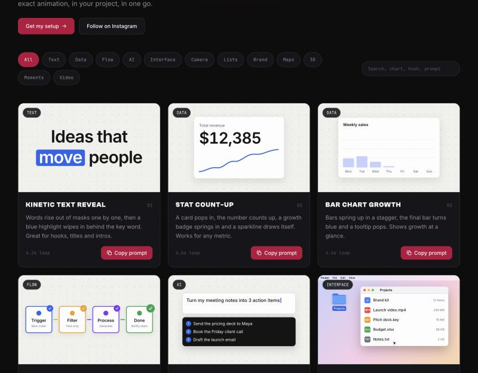

<div align="center">

# Motion Library

**50 copy-ready motion graphics for Claude.**
Preview them. Click **Copy prompt**. Paste into Claude. Get the exact animation in your project.

[](LICENSE)
[](#install)



</div>

Claude can build motion graphics now, but starting from a blank prompt rarely gets you something that looks great.
Motion Library gives you a dashboard of 50 hand-tuned animations. Every card plays live, and its **Copy prompt** button copies a prompt plus the full code, so Claude recreates exactly what you saw.

Built by [samerflows](https://samerflows.com). Free to use, forever.

## Install

You need [Claude Code](https://claude.com/claude-code). Then run these two commands inside it:

```
/plugin marketplace add SamerEladad/motion-library
/plugin install motion-library@samerflows
```

Restart Claude Code if it asks you to, then open the dashboard:

```
/motion-library
```

The dashboard opens in your browser. It is a single local file, so it works offline (fonts load from the web when you are online).

## How to use it

1. Run `/motion-library` and browse the cards.
2. Hit **Copy prompt** on the one you like.
3. Paste it into Claude, in any project that uses React.
4. Tell Claude your own words, numbers or colours and it swaps them in.

You can also just ask by name, for example: *"Add the Kanban Drag motion graphic to my landing page."* The plugin's skill knows every graphic in the library.

## What is inside

| Category | Motion graphics |
| --- | --- |
| **Text** | Kinetic Text Reveal, Word Roll, Strike & Replace, Testimonial Quote, Text Scramble, Marquee Ticker |
| **Data** | Stat Count-Up, Bar Chart Growth, Donut Chart, Leaderboard Race, Line Chart Draw, Progress Ring Stat |
| **Flow** | Automation Pipeline, Integration Orbit |
| **AI** | Prompt Typewriter, Chat Conversation, Code Typing |
| **Interface** | macOS Folder Open, Phone Tap, Notification Stack, Drag & Drop Upload, Settings Toggles, Command Palette, Follow Button, Skeleton Loading, Pricing Cards, Kanban Drag, Email Send, Audio Waveform |
| **Camera** | Camera Pan & Zoom, Before / After Slider, Rack Focus, Versus Split |
| **Lists** | Icon List Cascade, Calendar Schedule |
| **Brand** | Lower Third, Logo Reveal |
| **Maps** | Map Route |
| **3D** | 3D Card Flip, Perspective Tunnel |
| **Moments** | Countdown Timer, Success Burst, Time Saved Clock |
| **Video** | Caption Highlight, Punch Zoom, Number Takeover, Color Block Title, Picture in Picture, Price Tag Swing, Checklist Card |

## Requirements for the graphics themselves

Each graphic is one self-contained React component.

- React 18 or 19
- [`motion`](https://motion.dev) (`npm i motion`)
- Tailwind CSS v4

They size themselves with container-query units, so they scale to any parent width at a 16:10 ratio. Vertical "Video" graphics sit in a 9:16 frame inside that stage. They respect `prefers-reduced-motion`.

## Add your own graphic

1. Drop a self-contained `.tsx` into `skills/motion-library/graphics/` (copy any existing one as a starting point).
2. Add an entry to `skills/motion-library/catalog.json` with the same `id` as the filename.
3. Rebuild the dashboard:

```bash
cd app
npm install
npm run build
```

The build writes the single-file dashboard to `dashboard/index.html`.

## Project layout

```
.claude-plugin/        plugin and marketplace manifests
commands/              the /motion-library command
skills/motion-library/ catalog.json + one .tsx file per graphic + the skill
dashboard/             the built, single-file dashboard
app/                   source for the dashboard (Vite + React + Tailwind)
```

## Get my setup

I share the workflows, prompts and systems I use to save time and make money with AI in my newsletter.

- Newsletter and setup: [samerflows.com](https://samerflows.com)
- Instagram: [@samerflows](https://instagram.com/samerflows)

## License

[MIT](LICENSE). Use the graphics in personal and commercial projects, no attribution required.
